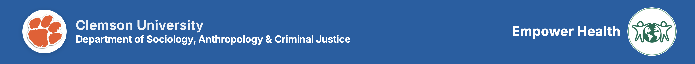
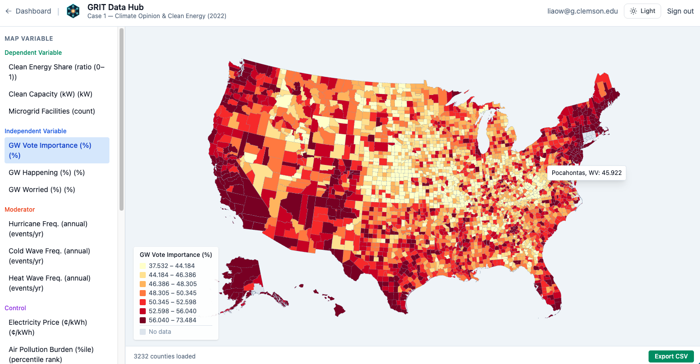
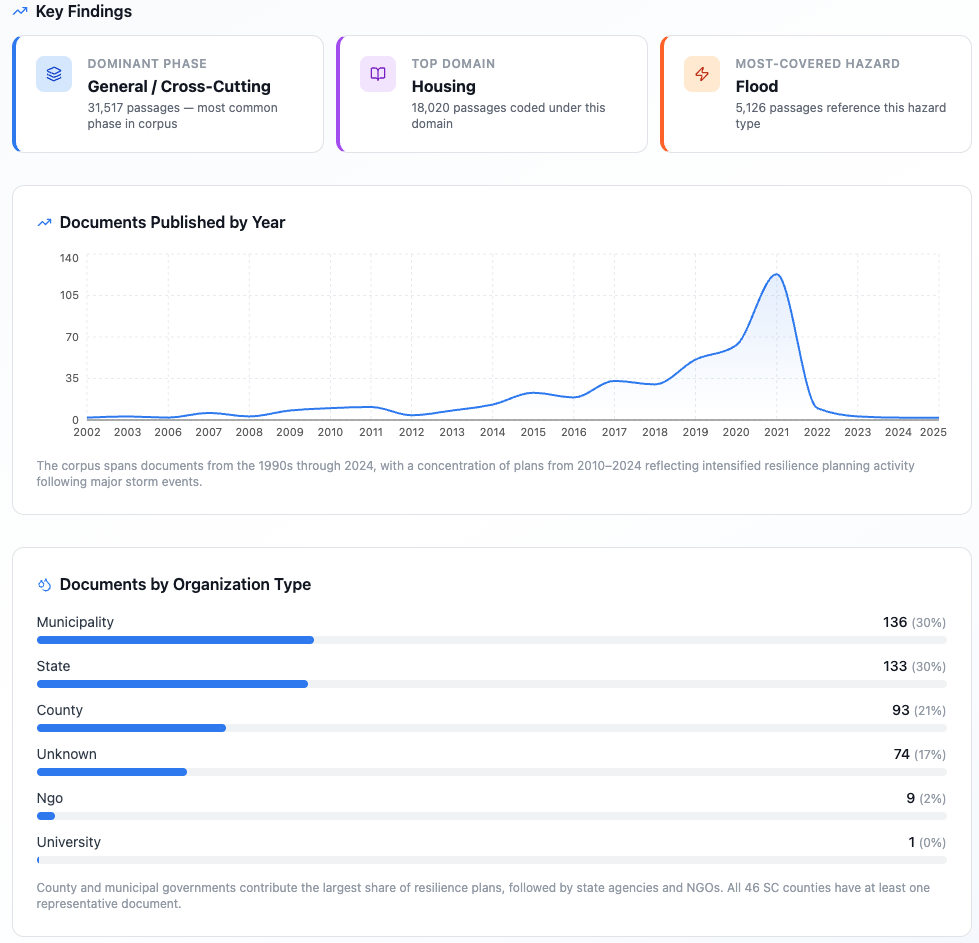
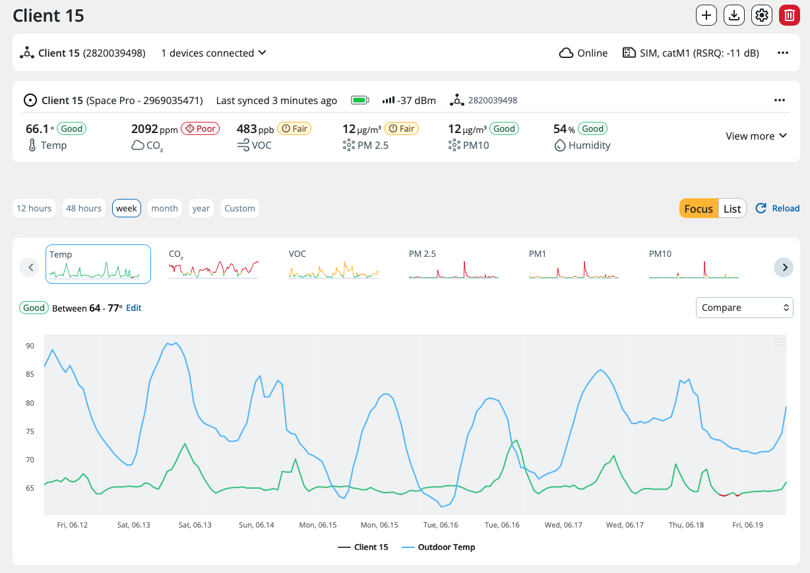
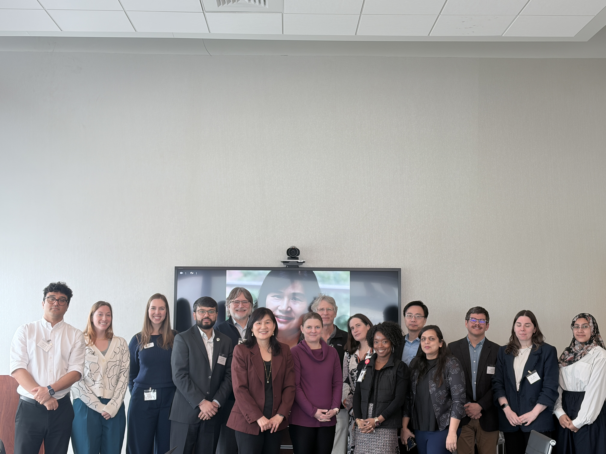

<p align="center">
  
</p>

<h1 align="center">
🌎 Wellcome Climate–Energy–Health Resilience Project
</h1>

<p align="center">
Advancing climate mitigation and resilience solutions with health co-benefits through interdisciplinary research, community engagement, policy innovation, and open science.
</p>

<p align="center">


</p>

---

# 🎯 About the Project

This project is funded by the **Wellcome Trust** under the program:

### Advancing Climate Mitigation Policy Solutions with Health Co-Benefits in G7 Countries

**Award #227151/Z/23/Z**

Our project examines the complex interactions among:

- Climate Change
- Energy Systems
- Public Health
- Social Vulnerability
- Community Resilience

through interdisciplinary research, community partnerships, policy analysis, and open data tools.

---

# 🌐 Project Website

### Main Website

🔗 https://wellcome-lab.vercel.app/

The project website serves as the public-facing platform for:

- Publications
- Dashboards
- News
- Community Engagement
- Educational Materials
- Research Outputs

---

# 👩‍🔬 Principal Investigator

<p align="center">

</p>

### Dr. Chien-fei Chen

Director, GRIT Lab

Department of Sociology, Anthropology, and Criminal Justice

Clemson University

Research Areas:

- Climate Resilience
- Energy Burden
- Power Outages
- Environmental Health
- Community Resilience
- Energy Justice

---

# 🔬 Research Themes

## ⚡ Electrification & Weatherization

- Household electrification
- Energy affordability
- Weatherization co-benefits
- Power outage resilience
- Energy equity

---

## 🏠 Healthy Home Intervention

- Indoor Air Quality (IAQ)
- Sensor deployment
- Environmental health monitoring
- Healthy housing
- Educational outreach

---

## 🌩 Power Outages, Climate & Health

- Extreme weather
- Energy insecurity
- Disaster exposure
- Health vulnerability
- Community resilience

---

## 🧠 AI & Resilience Policy Analysis

- AI-assisted policy review
- Community-informed resilience planning
- Policy codebooks
- Citizen science
- Resilience scoring

---

## 📊 Climate–Energy–Health Data Integration

- Multi-domain datasets
- GIS dashboards
- Vulnerability mapping
- Open data tools
- Decision-support systems

---

# 📊 Public Platforms

## GRIT Data Hub



🔗 https://grit.hitslab.app

Integrated Climate–Energy–Health database supporting vulnerability assessment and resilience planning.

---

## SPARC Policy Dashboard



🔗 https://sparc.hitslab.app

AI-assisted resilience policy analysis platform supporting community-informed decision-making.

---

# 🏠 Healthy Home Intervention



Current activities include:

- Household recruitment
- Indoor air quality monitoring
- Sensor deployment
- Baseline and follow-up surveys
- Educational materials
- Community engagement

The intervention aims to improve indoor environmental quality, reduce energy burden, and support healthier homes.

---

# 🤝 Community Engagement



Current engagement activities include:

- Focus groups
- Stakeholder interviews
- Community workshops
- Healthy Home outreach
- Personal stories
- Community partnerships

---

# 🚀 Research Outputs

This repository hosts:

### 📚 Publications
- Journal articles
- Reports
- Conference presentations

### 📊 Dashboards
- GRIT Data Hub
- SPARC Dashboard
- GIS tools

### 🗂 Datasets
- Climate
- Energy
- Health
- Policy
- Power outage

### 📄 Policy Products
- Policy briefs
- White papers
- Codebooks

### 🎓 Educational Resources
- IAQ flyers
- Healthy Home materials
- Outreach products

### 🧪 Research Tools
- Models
- Surveys
- Documentation
- Case studies

---

# 🌐 Project Partners

<p align="center">


</p>

---

# 📂 Repository Structure

```text
case-studies/
dashboards/
data/
images/
models/
policy-whitepapers/
publications/
surveys/
README.md
```

---

# 🌍 Open Science Commitment

We are committed to:

- Open Science
- Reproducible Research
- Data Sharing
- Community Engagement
- Policy Translation

This repository serves as a living platform for sharing datasets, dashboards, publications, educational materials, and community-informed research products.

---

# 📚 Citation

This project is funded by the Wellcome Trust under the program:

**Advancing Climate Mitigation Policy Solutions with Health Co-Benefits in G7 Countries**

Award #227151/Z/23/Z
