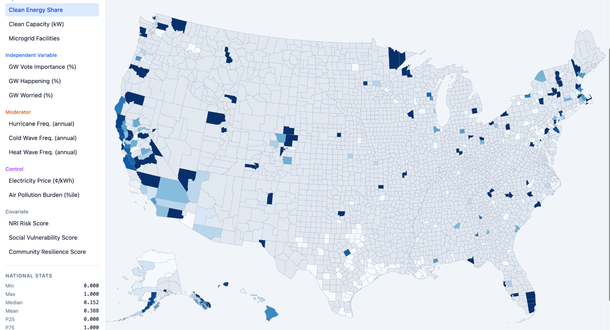

  

# 🌍 Wellcome Project Data Hub

## Health • Energy • Climate • Resilience

The **Wellcome Project Data Hub** is an interactive geospatial platform developed to support research on the **health co-benefits of the clean energy transition**.

It integrates nationwide datasets related to **energy**, **public health**, **climate**, **environment**, **community resilience**, and **social vulnerability** into a single web-based platform for visualization, exploration, and policy analysis.

### 🚀 Launch the Data Hub

## https://grit.hitslab.app

[**🌐 Open Wellcome Project Data Hub**](https://grit.hitslab.app)

---

# Overview

The Data Hub serves as a centralized platform for integrating and visualizing interdisciplinary datasets that support research, education, and evidence-based decision making.

Researchers, policymakers, community organizations, and the public can explore spatial patterns, compare indicators, and better understand the interactions among energy systems, environmental conditions, and population health.

---

# Key Features

### 🗺 Interactive GIS Mapping

Visualize county-level spatial distributions across the United States.

Current mapping capabilities include:

- Clean Energy Share
- Clean Energy Capacity
- Microgrid Facilities
- Climate Change Beliefs
- Extreme Weather Frequency
- Electricity Prices
- Air Pollution Burden
- National Risk Index (NRI)
- Social Vulnerability
- Community Resilience

---

### 📊 Integrated Public Datasets

The platform currently integrates data from multiple trusted sources, including:

- ⚡ U.S. Energy Information Administration (EIA)
- 🏥 Centers for Disease Control and Prevention (CDC)
- 🌪 Federal Emergency Management Agency (FEMA)
- 🌎 Environmental and Climate Data
- 📈 U.S. Census Bureau
- 🔋 Electric Power Outage Data
- 🌡 Extreme Weather Indicators
- 🗺 Geographic Information System (GIS) Layers

Additional datasets will be incorporated as the project progresses.

---

# Research Applications

The Data Hub supports interdisciplinary research in:

- Clean Energy Transition
- Energy Justice
- Energy Burden
- Climate Adaptation
- Community Resilience
- Public Health
- Environmental Justice
- Indoor Air Quality
- Weatherization
- Disaster Preparedness
- Policy Analysis

---

# Current Status

✅ Public web platform available

🔄 Continuous data updates

🧩 Additional dashboards under development

Future dashboards may include:

- Indoor Air Quality Dashboard
- Weatherization Dashboard
- Energy Burden Dashboard
- Community Health Dashboard
- Policy Analytics Dashboard
- Climate Resilience Dashboard

---

# Related Repository Sections

This dashboard is one component of the **Wellcome Project Research Repository**.

Additional project resources can be found in:

- 📂 Data
- 🤖 Models
- 📚 Publications
- 📄 Policy White Papers
- 📝 Surveys
- 📖 Case Studies

---

# Citation

If you use the Wellcome Project Data Hub in your research or publications, please cite the associated publications when available.

---

## 🌱 Turning Data into Knowledge • Knowledge into Action

### Wellcome Project Data Hub

Health • Energy • Climate • Resilience

🌐 https://grit.hitslab.app

